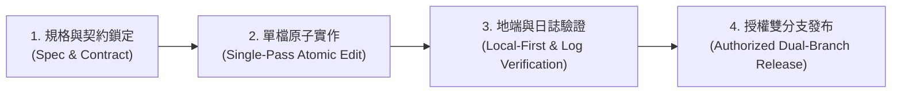

# 全工作區多軌統一開發流程與互動決策引導規範 (Unified Multi-Track Workflow & Interactive Decision Gate Rule)

## 1. 規範宗旨 (Purpose)
本規範為 `AI_Projects` 全工作區之最高開發流程準則。工作區涵蓋 ESP32 嵌入式韌體、C# WinForms 工控機台、Python 桌面便攜工具與純前端 Web 應用。為確保開發品質、杜絕盲目臆測並尊重使用者決策權，導入「多軌合流統一生命週期」與「執行前主動詢問與功能選單機制」。

---

## 2. 頂層 4 階段統一生命週期 (Core 4-Stage Lifecycle)
所有專案之任何新增、修改、重構或修復任務，一律依序遵守以下四階段：

1. **Stage 1: Spec & Contract (規格與契約鎖定)**：
   - 明確定義輸入輸出、資料結構、通訊封包 HEX、API 格式或數學公式。
   - 嚴禁未經規劃直接盲改商業邏輯。
2. **Stage 2: Single-Pass Atomic Edit (單檔原子實作)**：
   - 嚴格遵守單檔一次性通盤修改，一次整合變數宣告、邏輯實作與 UI 綁定，編譯一次通過，杜絕零碎拖沓。
3. **Stage 3: Local-First & Log Verification (地端優先與日誌驅動驗證)**：
   - 依賴真實客觀日誌（`Auto_Raw_Telemetry_*.csv` 或終端輸出），佐證修復結果。
   - 驗收完畢強制主動清空暫存日誌與截圖（用畢即清）。
4. **Stage 4: Authorized Dual-Branch Release (發布閘門與雙分支同動)**：
   - 僅在使用者明確發布指令下執行 `git push`。
   - 強制同動 `gh-pages` 與 `master` 分支，並主動回報發布版號。

---

## 3. 四大領域專案子軌道 (Track-Specific Sub-Workflows)

### ▍Track A: ESP32 韌體與物聯網採樣 (`ESP32_*`)
* **採樣與解碼分工（免頻繁燒錄原則）**：
  * ESP32 專職硬體前端微秒級採樣，輸出客觀時序 `[TIMING_RAW]` 與原始 HEX 電文。
  * 軟體解碼與新演算法（如 TPMS 壓力平方律、溫度 Offset、濾波）一律在上層 GUI 或 Python 腳本熱重算驗證，禁止頻繁重複燒錄 ESP32。
* **物理量零偽造**：嚴禁任何預設假數據或腦補值，無空中封包時誠實顯示 `--`。

### ▍Track B: C# WinForms 工控機台 (`Dyanmometer`, `Automation_Studio_*`)
* **Windows XP & .NET 4.0 終身相容**：全自繪啟用 `DoubleBuffered`，嚴禁使用高版本 API 與現代 TLS 直連。
* **物理互斥排版**：頂層強制使用 `Root TableLayoutPanel`，內部全面廢除靜態座標，容器一律 `AutoScroll = true`。
* **Emoji 100% 禁用**：所有按鈕與標籤文字嚴禁使用 U+1F000 以上字元，避免 GDI+ 文字消失。
* **單一整合 CSV 日誌**：事件、HEX 電文與多相電氣量一律整合進單一檔案，嚴禁多檔拆分。

### ▍Track C: Python 桌面與便攜工具 (`TOOL_*`, 如 Stock Portfolio Tracker)
* **資料與 UI 解耦 (CLI-First)**：網路請求（TWSE MIS / Yahoo）與損益計算一律先以 CLI 腳本離線驗算通過後，才串接 Tkinter。
* **執行緒隔離**：耗時操作放背景工作線程，主線程僅負責介面安全更新。
* **密碼學防護**：涉及雲端備份必須符合 E2EE（PBKDF2 >= 600,000 + AES-256-GCM + AAD 綁定）。
* **純 ASCII 啟動檔**：所有 `.bat` 啟動器 100% 純 ASCII，中文輸出由 Python 接管。

### ▍Track D: 純前端 Web 工具與計算器 (`WEB_*`, `*.html`)
* **輕量零依賴**：現代 Vanilla HTML/CSS/JS，深色質感與自適應排版。
* **靜默驗收**：嚴禁未獲授權擅自彈出本機瀏覽器視窗干擾使用者。

---

## 4. 「首問即全貌、選定即貫徹」端到端決策引導機制 (Upfront Alignment & Autonomous End-to-End Execution)

### 4.1 核心痛點防禦：杜絕瑣碎碎步提問 (Zero Mid-Way Nagging)
* **嚴格禁止「做一步問一步」**：在流程執行過程中，嚴禁每完成一個微小子任務（如修好一行 code、跑完測試、或更新完版號）就反覆中斷停步並向使用者發問「下一步請選擇」。這種碎步互動會嚴重浪費時間、割裂工作節奏。
* **首問即全貌 (Full-Spectrum Upfront Plan)**：所有需要使用者決策或選擇的事項，**必須在最初的第一次提問時就一次性說明完整**，將「從起點到終點」的整套端到端路徑、可選方案（包含分析、修復、單元測試、封裝打包、版號更新、地端啟動）全貌攤開供使用者選擇。

### 4.2 執行方式 (Execution Mechanism)
1. **起點一次性完整列案 (First-Turn Comprehensive Menu)**：
   AI 遇到新任務或關鍵決策時，主動調用 `ask_question` 或條列完整端到端方案，例如：
   - **方案 A (端到端完整落地 - 推薦)**：從根本原因分析 $\rightarrow$ 單檔原子修復 $\rightarrow$ 離線單元測試驗收 $\rightarrow$ 雙層架構同步與二進位封裝 $\rightarrow$ 版號同步遞增 $\rightarrow$ 本地實機啟動常駐，一步到位直達交付！
   - **方案 B (輕量驗證模式)**：僅建立離線測試與模擬驗算，不變更主程式與版號。
   - **方案 C (純架構診斷)**：僅提供代碼檢查與分析報告，不執行任何寫入。
2. **選定即自主貫徹至終點 (Run to Completion Without Interruption)**：
   - 當使用者點選或回覆選定之方案後，AI **必須立即一口氣自主連續執行該方案的所有工序**（分析 $\rightarrow$ 編輯 $\rightarrow$ 測試 $\rightarrow$ 編譯 $\rightarrow$ 啟動）。
   - **中途絕不反覆停步詢問**，直接執行到底！
   - **一次性總結成果**：所有步驟全部完成後，才輸出清晰、包含實測日誌佐證的最終成果報告，交由使用者驗收。

